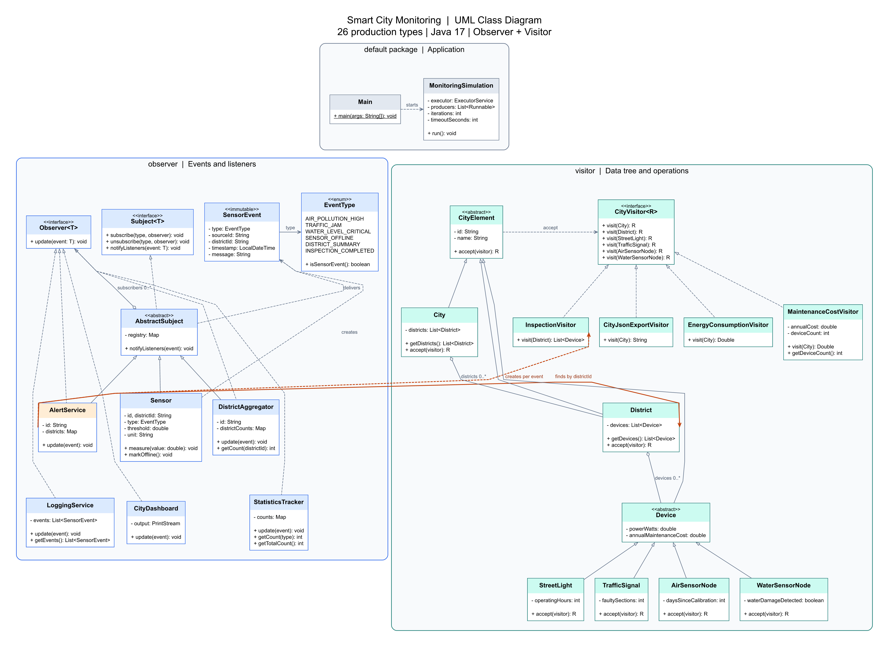

# Smart City Monitoring

A console project demonstrating the Observer and Visitor patterns.
Sensors publish events to city services. An alert starts an inspection of its
own district, and the inspection result returns as a new event.


## UML class diagram



Open the image to zoom in. The [SVG version](docs/uml.svg) stays sharp at any zoom
level. The [Graphviz source](docs/uml.dot) can be edited when the classes change.
These files are documentation assets; no diagram tool is needed to run the project.

The diagram shows all **26 production types** in two named packages and the default package: 22 classes,
three interfaces, and one enum. Constructors, most getters, and external Java
library classes are omitted. Concrete visitors implement all six `visit`
overloads; the diagram shows their result types and selected members.
Only the key dependencies are drawn. `Main` creates and connects all application
objects, and the orange arrows highlight the Observer-to-Visitor integration.
`AbstractSubject` implements `Subject<SensorEvent>`; all five listeners implement
`Observer<SensorEvent>`.

| UML notation | Meaning in this project |
|---|---|
| Solid line with a hollow triangle | Inheritance through `extends`; the triangle points to the parent |
| Dashed line with a hollow triangle | Interface implementation through `implements` |
| Line with a hollow diamond | A container holds references to children or subscribers |
| Solid arrow | A stored reference to another object or type |
| Dashed arrow | A class uses or creates another class |
| `0..*` | A collection can contain zero or more objects |
| `+` / `-` | Public / private member |

Hollow diamonds are used because constructors receive existing objects and copy
their lists. The same child could technically be passed to more than one container.
In the sample city, each district and device appears once.


## Project structure

```text
src/main/java/
    Main.java
    MonitoringSimulation.java
    observer/    events, sensors, subscriptions, and five listeners
    visitor/     the city tree and four visitors

src/test/
    ObserverTest.java
    VisitorTest.java
    SimulationTest.java
    ApplicationTest.java

docs/
    uml.png
    uml.svg
    uml.dot
```

| Package | Types | Purpose |
|---|---:|---|
| Default package | 2 | Create the application and manage worker threads |
| `observer` | 11 | Two interfaces, the shared registry, event and enum, sensor, and five listeners |
| `visitor` | 13 | Two containers, four leaf types, two base classes, the visitor interface, and four operations |

`Main`, `MonitoringSimulation`, and the test classes are in the default package.
The event classes use `observer`, and the tree and visitors use `visitor`.
Maven is configured to read tests from `src/test`, matching the IDEA test root.
Tests have no package declaration so they can call `Main` and its sample-data methods.

The assignment specifies roles and minimum numbers of sources, listeners, and
element types rather than a fixed total number of classes. The four leaf types,
four visitors, and five listeners are kept separate because they have different
roles. Base classes hold common data or subscription logic.

## Observer

`Subject<T>` and `Observer<T>` are custom generic interfaces. `AbstractSubject`
implements the subscriber registry. Listeners subscribe to a particular `EventType`
and receive matching `SensorEvent` objects through `update`.

The project uses **push**: the complete event is passed to the listener.
Each listener gets the data of that event. With pull, a listener would request
the source's current state, which another producer might already have changed.

`SensorEvent` is immutable: the class is `final`, its fields are `private final`,
and it has no setters. Its strings, event type, and `LocalDateTime` value are also
immutable. One listener cannot change the message received by another listener.
The fields are `type`, `sourceId`, `districtId`, `timestamp`, and `message`.

One configurable `Sensor` class provides three independent source objects.
Each has its own identifiers, event type, threshold, units, and subscriber registry.

| Source | Event type | Alert condition | Unit |
|---|---|---|---|
| Air | `AIR_POLLUTION_HIGH` | Reading > 150 | AQI, a dimensionless index |
| Water | `WATER_LEVEL_CRITICAL` | Reading > 5 | Metres above the channel bottom |
| Traffic | `TRAFFIC_JAM` | Reading > 60 | Vehicles per kilometre of one lane |

These are teaching thresholds, not real monitoring standards. A reading at or below
the threshold produces no event. Negative values, `NaN`, and infinities are rejected.
`markOffline()` publishes `SENSOR_OFFLINE`; it does not store a connection state.

| Listener | Responsibility |
|---|---|
| `CityDashboard` | Print an event to the supplied `PrintStream` |
| `StatisticsTracker` | Count original sensor events by type |
| `LoggingService` | Keep events in memory and return an immutable snapshot |
| `DistrictAggregator` | Count events per district and publish `DISTRICT_SUMMARY` |
| `AlertService` | Inspect the event's district and publish `INSPECTION_COMPLETED` |

All five services subscribe to original sensor events. The dashboard and logger
also receive district summaries and inspection results. Statistics, aggregation,
and alerts ignore derived events, preventing repeated processing of their results.

`DistrictAggregator` demonstrates a chain of observers: it receives an event as
an Observer and publishes an aggregate as a Subject. `AlertService` also has both roles.

## Visitor

The immutable tree has three levels: **City → District → Device**.
`City` and `District` are the two container types. The four concrete leaf types
are `StreetLight`, `TrafficSignal`, `AirSensorNode`, and `WaterSensorNode`.

`CityElement` holds the identifier and name. `Device` adds power and annual
maintenance cost. Elements hold data, getters, and `accept`; operations live
in the visitors. Containers defensively copy their lists with `List.copyOf`.

Each concrete `accept` calls `visitor.visit(this)`. `CityVisitor<R>` has a `visit`
overload for each concrete element type. `R` is the result type, such as `Double`,
`List<Device>`, or `String`.

**Visitors perform traversal.** `visit(City)` loops over districts and calls their
`accept` methods. `visit(District)` does the same for devices. The element's `accept`
only dispatches the call; it does not visit children.

This keeps operations out of the elements and lets each visitor combine results
in its own way: sum numbers, collect devices, or nest JSON objects. Traversal can
start at one district, which is needed for an inspection triggered by an event.
The cost is similar traversal loops in several visitors; for this small tree,
these loops are easier to follow than a separate traversal framework.

| Visitor | Result |
|---|---|
| `EnergyConsumptionVisitor` | Total power in watts |
| `MaintenanceCostVisitor` | Accumulated annual maintenance cost; device count is available through a getter |
| `InspectionVisitor` | Immutable list of devices requiring inspection |
| `CityJsonExportVisitor` | Hand-written JSON with correct nesting and escaping |

Create a new `MaintenanceCostVisitor` for an independent calculation. Reusing an
instance continues accumulation. Its mutable state is not shared between threads.
The power calculation uses watts; it does not calculate energy over a time period.

Inspection selects street lights with at least 10,000 operating hours, signals
with faulty sections, air nodes with at least 365 days since calibration, and
water nodes with water damage. These are rules for the teaching example.
JSON export escapes quotes, backslashes, and control characters without a library.

### Hand-calculated results

| Subtree | Power, W | Maintenance, KZT/year | Inspection result |
|---|---:|---:|---|
| Central district | 100 + 200 + 10 + 20 = 330 | 1000 + 2000 + 3000 + 4000 = 10000 | `light-1`, `air-node-1` |
| Riverside district | 50 + 150 + 15 + 25 = 240 | 500 + 1500 + 2500 + 3500 = 8000 | `signal-2`, `water-node-2` |
| Entire city, 8 devices | 570 | 18000 | The four devices listed above |

## Following one event

Example: `air-1` in `district-1` receives a reading of 200 AQI.

1. `Sensor.measure` compares 200 with the threshold of 150 and creates an
   `AIR_POLLUTION_HIGH` event.
2. `AbstractSubject` copies the subscribers for this event type and calls `update`.
3. The dashboard prints the event, statistics increments its count, and the logger
   stores the event.
4. `DistrictAggregator` increments the district's count and publishes
   `DISTRICT_SUMMARY` to the dashboard and logger.
5. `AlertService` finds `district-1` in its map and calls
   `district.accept(new InspectionVisitor())`.
6. The visitor checks the four devices in that district and finds `light-1` and
   `air-node-1`. It does not traverse the other district.
7. `AlertService` publishes `INSPECTION_COMPLETED` with the device identifiers.
   The dashboard and logger receive this result.

One original event produces three log entries: the event, its summary, and its
inspection result. Derived events do not increase the original-event count.
An unknown district is reported to `System.err`; the service does not inspect
the whole city as a fallback. Events do not change the tree.

## Concurrency and shutdown

`Main` creates a fixed thread pool and passes it to `MonitoringSimulation`.
Producers alternate between air, water, and traffic. The simulated readings are
fixed at 200 AQI, 6 m, and 80 vehicles/km, so each reading produces an alert.

The registry, statistics, district counts, and log use ordinary collections
protected by short `synchronized` blocks. Reading, incrementing, and writing
a count happen together. Without this protection, two threads could both read
10 and write 11, losing one increment instead of reaching 12.

The subscriber list is copied under its lock. Handlers are called **after releasing
the lock**, so a slow listener does not block other threads from changing subscriptions.
The aggregator also releases its counter lock before publishing a summary.

An active delivery finishes using its snapshot. Unsubscribing changes future
snapshots, but cannot cancel deliveries already copied by other threads.
A listener added inside a handler receives events from subsequent snapshots.

Handlers run synchronously in the producer's thread. A completed producer task
has finished its event deliveries. Different producers can call a listener at
the same time, so there is no guaranteed global event order.

`MonitoringSimulation` shuts down in this order:

1. `submit` sends producer tasks to the pool.
2. `shutdown` stops accepting new tasks while allowing submitted tasks to finish.
3. `awaitTermination` waits for completion; `Future.get` checks for task failures.
4. A successful return from `run()` allows `Main` to print the final report.

The default time limit is 30 seconds. On timeout or interruption, tasks are cancelled
with `cancel(true)` and `shutdownNow`, followed by up to five seconds of shutdown
waiting. Producers check the interruption flag before each reading.
Interruption is cooperative: arbitrary code that ignores it cannot be forcibly
stopped by this mechanism. The pool is closed after one simulation run.

On normal successful completion, all readings and their notifications have been
processed before the final report. On cancellation, remaining readings may not
happen, and no success report is printed. If a listener throws `RuntimeException`,
the subject reports it and continues with other listeners; it does not retry
the failed handler. The exact-count tests cover handlers that complete successfully.

| Run settings | Original events | District summaries | Inspection results | Log entries |
|---|---:|---:|---:|---:|
| Default: 3 threads × 5 readings | 15 | 15 | 15 | 45 |
| Stress: 4 threads × 1000 readings | 4000 | 4000 | 4000 | 12000 |

In the stress run, air produces 2000 original events, water and traffic produce
1000 each. District counts are 3000 and 1000. The dashboard also receives 12000 events.

Event counters and street-light operating hours use `int`, which is sufficient
for the sample data and the required stress test. Shared counters remain protected
by `synchronized`.

## Tests

There are exactly **15 ordinary `@Test` methods** in four classes, with no
parameterised invocations or separate test helper classes.

| Test class | Tests | Main scenarios |
|---|---:|---|
| `ObserverTest` | 4 | Typed subscriptions, handler-time changes, thresholds, aggregation, and log snapshots |
| `VisitorTest` | 5 | Four visitors, manual calculations, JSON, and immutable containers |
| `SimulationTest` | 5 | Exact 4 × 1000 stress run, district-only inspection, locks, failure, timeout, and interruption |
| `ApplicationTest` | 1 | Direct `Main` calls with default, custom, and invalid arguments |

The suite has been verified: 15 passed, no failures, errors, or skipped tests.
Concurrency tests use `CountDownLatch` with bounded waits rather than random sleeps.
One test intentionally produces a listener-error diagnostic to check continued delivery.

## Visitor extension trade-offs

The assignment requires two separate extension commits. **They have not been made
yet.** The following examples are plans, not records of completed changes.
After implementation, record each commit hash and its actual changed files.

### Adding an operation

A planned `DeviceCountVisitor implements CityVisitor<Integer>` would return 1
for a leaf and add child results in a container. The maintenance visitor already
counts devices; a separate visitor would make counting an independent operation.

| Planned files | Change |
|---|---|
| `src/main/java/visitor/DeviceCountVisitor.java` | Add a visitor implementing all six existing overloads |
| `src/main/java/Main.java` | Use it in the final report |
| `src/test/VisitorTest.java` | Check 8 devices in the city, 4 in a district, and 0 in an empty tree |
| `README.md`, `docs/uml.dot`, diagram images | Update the diagram and record actual changes |

No element class or `CityVisitor` change is needed. The cost is implementing
the existing element operations in the new visitor. The test-method count can
remain 15 by extending an existing numeric-visitor test.

### Adding an element type

A planned `NoiseSensorNode extends Device` would store a noise reading and provide
its own `accept`. It is a Visitor tree element; a new Observer producer is not
required for this example.

| Planned files | Change |
|---|---|
| `src/main/java/visitor/NoiseSensorNode.java` | Add data and `accept` for the new leaf |
| `src/main/java/visitor/CityVisitor.java` | Add `visit(NoiseSensorNode)` |
| The four current visitors in `src/main/java/visitor/` | Add power, maintenance, inspection, and JSON handling |
| `DeviceCountVisitor.java`, if already added | Count the new leaf |
| `src/main/java/Main.java` | Add the device to a sample district |
| `VisitorTest.java`, `SimulationTest.java` | Check the new type and update affected expected results |
| README, UML source and images | Update totals, types, and the actual file list |

`City` and `District` already accept `Device` objects, so they need no changes.
The interface and every visitor must handle the new type. The compiler identifies
visitors missing the new method. Original event counts stay the same, so the
15/45 and 8/24 expectations in `ApplicationTest` do not change.

Visitor fits a stable set of element types with frequently added operations.
If device types change often, updating all visitors becomes expensive.
